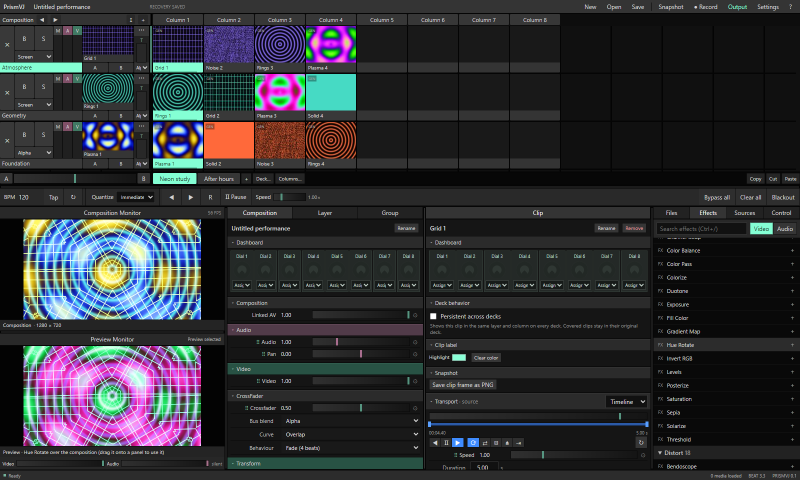
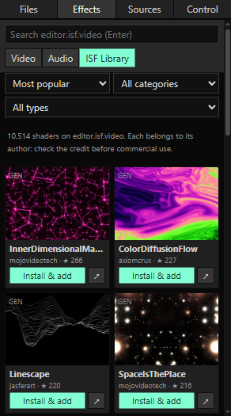
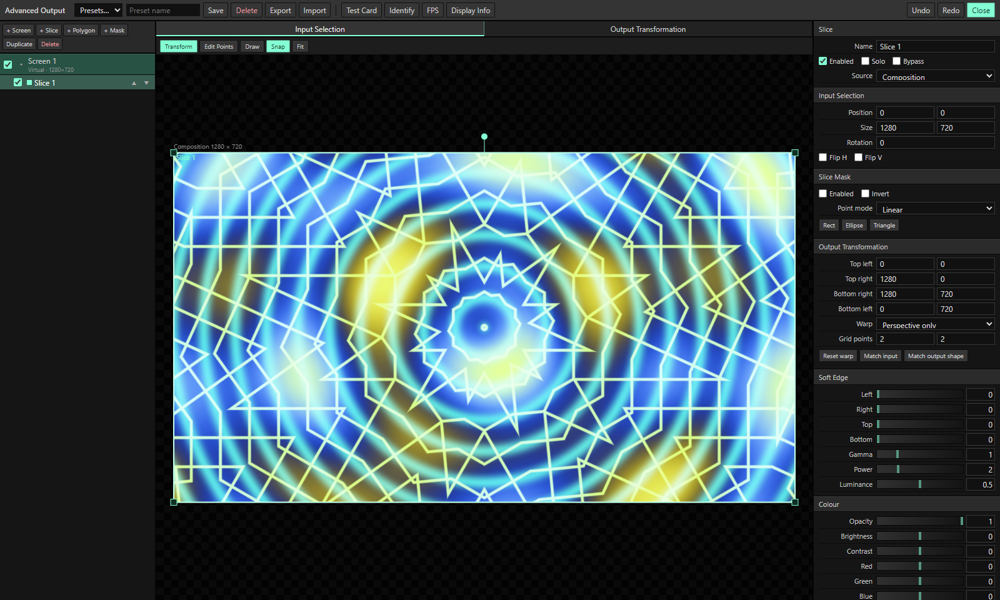

# PrismVJ

PrismVJ is a free, open-source alternative to Resolume™ Arena for live video performance on Windows. It does as much as possible on the GPU: HAP and DXV movies decode straight to textures, and mixing, effects and projection mapping run in WebGL2 shaders. It plays along with CDJs over Pro DJ Link, runs thousands of community shaders from the ISF library, and has Ableton Link, DMX (Art-Net and sACN), MIDI, OSC and SMPTE timecode.



## Features

### Playback and media
- **GPU-decoded HAP and DXV.** Hap, Hap Alpha, Hap Q, Hap Q Alpha, Hap Alpha-Only and DXV3 (normal and high quality, with or without alpha) play from the original file. Compressed DXT/BC textures go straight to the GPU, and reverse, speed changes and scrubbing are instant.
- **Other formats.** ProRes, Animation and other MOVs are converted through FFmpeg into cached playback copies, keeping alpha and audio. MP4, WebM, animated GIFs, still images and numbered image sequences also play.
- **Clip transport:** forward, reverse, pause, loop, ping-pong, random (with interval and distance), play once and eject, play once and hold. Also speed, in/out trimming, six cues, BeatLoopr, and restart or pick-up when you return to a clip.
- **Timing:** Timeline, BPM Sync and SMPTE timecode transport modes, plus beat snap and quantized triggering.
- **Audio:** each clip has its own soundtrack with volume and pan. You can pair a separate audio file with any visual, and Linked AV faders move audio and video together.
- **Recording and snapshots:** record the output with mixed audio, or save a PNG of the output or of a single clip. New recordings and snapshots drop into the clip bank.

### Composition
- **Decks, layers and columns.** Multiple decks with renameable columns, and clips can persist across decks.
- **Layers** have their own blend mode, opacity, audio, bypass and solo, plus mask mode, locking and auto-transitions.
- **Groups** work as sub-compositions with their own effects, transform, faders and column triggers.
- **Crossfader:** A/B buses with Overlap, Linear, Smooth or Cut curves, and Fade, Jump, Jump & Return or Cut behaviours.
- **Effect clips:** a slot can hold an effect that processes every layer beneath it.
- **Video Router:** route the layers below, or a chosen layer or group, back in as a source.
- **Preview monitor:** cue clips and effects before they go live.
- **Dashboards:** eight assignable dials on the composition, each layer and each clip.
- **Saving:** save and open compositions, autosave and crash recovery, missing-file relinking, and undo/redo.

### Effects and sources
- **100+ GPU video effects**, including every effect in the Resolume manual's effect list: colour, distortion, blur, stylize, keying, glitch, feedback and time effects (Stop Motion, Delay RGB, Freeze), tiling, Cube Tiles, Videowall, Luma Waves, Pixels In Space and more. Each has opacity, blend mode, bypass, presets and drag-to-reorder, on any clip, layer, group or the whole composition.
- **19 audio effects:** EQ, filters, delay, reverb, distortion, compressor, limiter, chorus, phaser, flanger, auto pan and more.
- **40 generators:** shapes, patterns, fractals, particles, lasers, audio spectrum and waveform, colour bars and a test card.
- **Text Animator** with per-character animation.
- **Live inputs** from capture devices and screen capture.
- **ISF Library**: search, preview and install over 10,000 effects, generators and transitions from [editor.isf.video](https://editor.isf.video/shaders) straight from the effects browser. Installed shaders load every time PrismVJ starts.
- **Full ISF support**: multi-pass, persistent and float buffers, custom pass sizes, vertex shaders, audio waveform and FFT inputs, extra image inputs, imported images and transitions, which work as layer blend modes, clip transitions and crossfader mixes. Shaders also import from `.fs` files and folders.



### Parameter animation
- Any parameter can run on **Timeline**, **BPM Sync**, **Clip Position**, a **Dashboard** dial, or **Audio Analysis** (FFT of the composition, a group, a layer, a clip or an external input).
- Each animation has its own transport: loop, bounce, random or once. You set duration in seconds or beats, drag the range directly on the slider, and can draw envelope curves.
- **Audio-reactive control** has adjustable band, gain, fall and response.

### Projection mapping (Advanced Output)
- Multiple screens with rectangular and polygon slices, slice masks, and a layer or group as each slice's input.
- Perspective, grid and bezier warping.
- Soft-edge blending with gamma, power and luminance.
- Per-slice colour correction, a test card, identify, output delay, and presets.
- Output windows get the composition from the GPU every frame.



### Control and sync
- **Pro DJ Link (CDJ / XDJ / DJM):** PrismVJ joins the DJ network as a virtual player. It shows what every deck is playing (title, artist, BPM, pitch, playhead, on-air and master) and can follow the master player's tempo and beat.
- **Track triggers:** map a song to a clip and that clip plays whenever the song plays on any deck, locked to the track's playhead and pitch. It holds when the DJ pauses and stops when the track is unloaded. Matching works by title and artist, so it follows the song across USB sticks.
- **Ableton Link:** tempo and beat phase stay in sync with Ableton Live, Traktor and other Link apps on the network, with optional start/stop sync.
- **MIDI:** learn mode, controller feedback, BPM from MIDI clock, and value, toggle, momentary, trigger, set and relative (encoder) modes.
- **OSC** input and feedback output.
- **DMX:** pixel-mapped fixture output over Art-Net or sACN, and DMX input for shortcuts.
- **SMPTE LTC** timecode input.
- **Keyboard shortcuts** for any control. Shortcut sets save as presets and can target a specific item or whatever is selected.
- **Tap tempo, resync** and global speed.

## Download

Get `PrismVJ-<version>-win-x64.zip` from the Releases page, extract it anywhere and run `PrismVJ.exe`. FFmpeg is included. Settings and recordings are stored in `%APPDATA%\PrismVJ`.

## Building from source

Requires Node.js 22+ and npm.

```powershell
npm ci
npm run build
npm start
```

| Command | Result |
| --- | --- |
| `npm run package` | Packaged app in `release/prismvj/PrismVJ-win32-x64` |
| `npm run release` | Package plus the all-in-one release zip in `release/` (includes FFmpeg from `C:\ffmpeg\bin`, `PATH` or `PRISM_FFMPEG_PATH`) |
| `npm run build:link` | Rebuild the Ableton Link module (needs Visual Studio C++ build tools and Python) |

## Keyboard

| Key | Action |
| --- | --- |
| F1–F3 | Select layer 1–3 |
| 1–0 | Trigger clip 1–10 in the selected layer |
| Shift + 1–0 | Trigger column 1–10 |
| Left / Right | Trigger adjacent clip (Shift selects only) |
| Enter | Trigger selection |
| Q W E R T Y | Jump to cue (Shift sets the cue) |
| Z X C V B N | BeatLoopr off / 4 / 2 / 1 / ½ / ¼ |
| , . / | Reverse / forward / pause clip |
| I / O | Set in / out at playhead |
| Space | Pause or resume composition |
| ` / Escape | Toggle / clear blackout |
| Ctrl+S / Ctrl+Shift+S / Ctrl+O | Save / Save as / Open |
| Ctrl+Z / Ctrl+Y | Undo / redo |
| Ctrl+C / Ctrl+X / Ctrl+V | Copy / cut / paste clips |
| Ctrl+Shift+K / Ctrl+Shift+M | Keyboard / MIDI shortcut mapping |
| Ctrl+/ | Search effects |

## License

PrismVJ is free software released under the [GNU General Public License v3.0 or later](LICENSE).

## Third-party software

PrismVJ includes [Ableton Link](https://github.com/Ableton/link) (GPLv2+), [Electron](https://www.electronjs.org/) (MIT) and, in release builds, [FFmpeg](https://ffmpeg.org/) (GPL). The Pro DJ Link support is based on Deep Symmetry's [dysentery](https://github.com/Deep-Symmetry/dysentery) protocol analysis and [prolink-connect](https://github.com/evanpurkhiser/prolink-connect) (MIT). Shaders from editor.isf.video belong to their authors. The licenses are in the `licenses` folder of each release.

Resolume is a trademark of Resolume BV. PrismVJ is not affiliated with or endorsed by Resolume.
